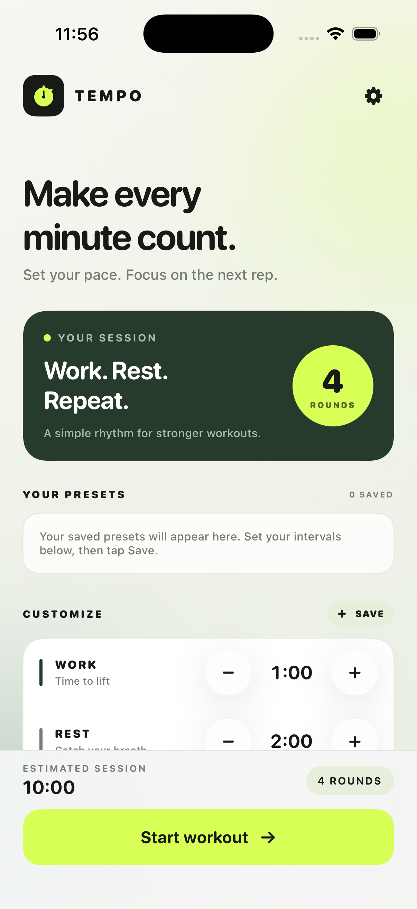
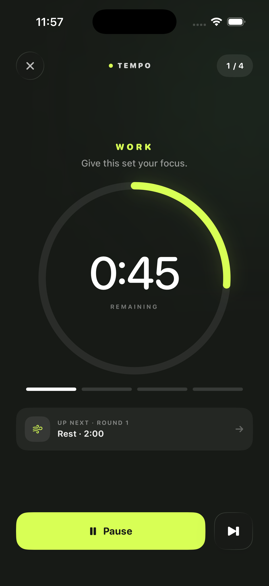

# Tempo — Gym Interval Timer

Tempo is a native SwiftUI iPhone app for building repeatable workout intervals. Set work, rest, preparation, and cooldown times, save your own presets, and run the session with a clear countdown.

## Features

- Create and save named workout presets with a custom SF Symbols icon
- Keep recently used and saved presets at the front of the preset list
- Set work, rest, optional preparation, and optional cooldown times in whole seconds
- Enter times directly or adjust them one second at a time
- Choose 1–20 rounds and see an estimated session duration
- Follow a countdown ring, round progress, and next-interval preview
- Pause, resume, skip an interval, or finish a session
- Choose automatic, light, or dark appearance and select an accent color
- Use Liquid Glass controls on iOS 26, with a material fallback on iOS 17–25

The timer recalculates from a deadline, so it catches up when the app returns to the foreground. Presets and appearance choices are stored on the device.

## Screenshots

| Setup | Countdown |
| --- | --- |
|  |  |

## Requirements

- macOS with Xcode 26 or later
- An iPhone running iOS 17 or later, or an iOS simulator
- No third-party packages are required

Xcode 26 is needed to build the app because the project uses the iOS 26 SDK's SwiftUI Liquid Glass APIs, while keeping iOS 17 as its minimum deployment target.

## Build and run in the iOS Simulator

1. Clone the repository:

   ```sh
   git clone https://github.com/YOUR-USERNAME/YOUR-REPOSITORY.git
   cd YOUR-REPOSITORY
   ```

2. Open `RepTimer.xcodeproj` in Xcode.
3. Select the **RepTimer** scheme and an iPhone simulator from the run destination menu.
4. Click **Run** (▶).

## Run on a physical iPhone

1. Open `RepTimer.xcodeproj` in Xcode and select the **RepTimer** project and app target.
2. In **Signing & Capabilities**, leave **Automatically manage signing** enabled and select your own **Team**. If Xcode reports that the bundle identifier is unavailable, change `com.codex.Tempo` to a unique identifier in the target's **Signing & Capabilities** settings.
3. Add your Apple Account in **Xcode > Settings > Accounts** if it is not listed as a team.
4. Connect the iPhone to the Mac, unlock it, and accept any trust prompts. Select the iPhone as the run destination and click **Run**.
5. If iOS asks, enable **Developer Mode** under **Settings > Privacy & Security**, then restart the iPhone and confirm the prompt.

For personal testing, a paid Apple Developer Program membership is not required. Apps signed with a free Personal Team provisioning profile need to be rebuilt and reinstalled after the profile expires (typically after 7 days). Each person who builds the app should select their own Apple development team in Xcode.

## Publish this repository on GitHub

The project is already a local Git repository on the `main` branch. To publish it:

1. Create a new repository on GitHub. For this existing project, leave **Add a README**, **Add .gitignore**, and **Choose a license** unchecked so GitHub creates an empty repository.
2. In Terminal, from this project folder, run the following commands. Replace the URL with the HTTPS or SSH URL GitHub gives you:

   ```sh
   git add .gitignore README.md RepTimer.xcodeproj RepTimer scripts
   git commit -m "Add Tempo workout timer"
   git remote add origin https://github.com/YOUR-USERNAME/YOUR-REPOSITORY.git
   git push -u origin main
   ```

3. Share the repository URL with your friend. If the repository is private, invite them as a collaborator in the repository's GitHub settings. They can clone it using the instructions above, open the Xcode project, and build it for the Simulator or their own iPhone.

If `origin` is already configured, update it with `git remote set-url origin YOUR-GITHUB-REPOSITORY-URL` instead of adding it again. GitHub may ask you to authenticate when pushing.

Uploading source code does not install the app on your friend's iPhone. For direct installation, they can build and sign it from Xcode using their own Apple account as described above. For installation without Xcode, distribute a signed build through TestFlight.

## License

This app is released under the [MIT License](LICENSE).

## App icon

The app icon is included in the asset catalog. To regenerate its image set from the included Swift script, run:

```sh
swift scripts/render_app_icon.swift
```

## Useful links

- [Add locally hosted code to GitHub](https://docs.github.com/en/migrations/importing-source-code/using-the-command-line-to-import-source-code/adding-locally-hosted-code-to-github)
- [Run your app on a device with Xcode](https://developer.apple.com/documentation/Xcode/running-your-app-on-simulated-or-physical-devices)
- [Enable Developer Mode on an iPhone](https://developer.apple.com/documentation/xcode/enabling-developer-mode-on-a-device)
- [Apple Developer account and Personal Team details](https://developer.apple.com/help/account/basics/about-your-developer-account)
